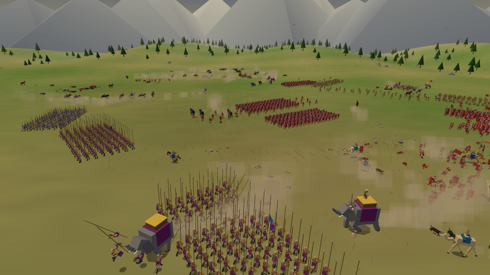
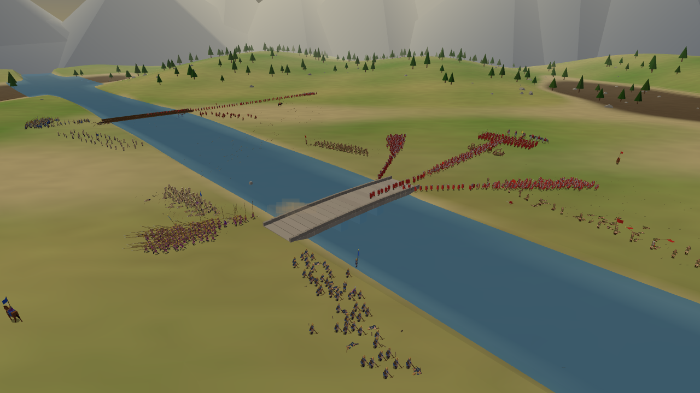
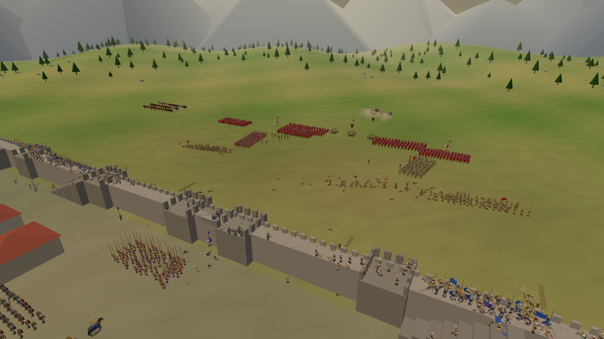

# Legiomachia

An ancient battle simulator in the browser (WebGL / three.js, plain JavaScript).

**Live demo: https://reki2000.github.io/legiomachia/**

Infantry, cavalry, war elephants, chariots, camels, war dogs and siege engines march, charge and crash into each other — with low-poly visuals and an emphasis on believable human motion.



| River crossing | Siege |
|---|---|
|  |  |

```
npm install
npm run dev        # http://localhost:5173/
npm run build      # static build in dist/
```

URL parameters: `?stage=field|hills|forest|canyon|river|ford|bridge|harbor|siege|camp|marsh|village|ambush|frozen|flood|firestorm|landslide|naval|burnforest`, `?weather=clear|fog|rain|snow|dusk|night`, `?mode=annihilate|capture|reinforce|retreat|escort`, `?cam=cine|free|follow|overview`, `?size=S|M|L|XL|XXL`, `?seed=<number>`, `?diff=easy|normal|hard`, `?autostart=<seconds>`

The seed can also be typed into the seed input in the control panel (the same value as `?seed=`), and the enemy AI difficulty chosen in the difficulty select (`?diff=easy|normal|hard`). Difficulty changes only the enemy command — how often its wings re-plan, when it commits its reserves, and how strongly its commanders' morale auras count — never unit stats or numbers; *normal* is the original behaviour. A battle with the same stage, size, mode and seed deploys identically, so a seed is enough to share a battle by URL.

## Stages

| Stage | Description |
|---|---|
| Open field | A pitched battle. Engineers drive anti-cavalry stakes before the fighting starts. |
| Hills | Two round hills flank the field. The high ground hits harder and uphill is slow going; each side's missile troops start on a hill. |
| Forest | Woods across the middle, every tree a solid block: men walk around them and arrows stop in them. Only a few lanes and glades are open, so the armies funnel through. |
| Canyon | Sheer cliffs close to a narrow neck. Formations form up narrower and deeper. |
| River crossing | A stone bridge, a wooden bridge and a ford. Regiments funnel into columns to cross. Defending engineers can destroy the wooden bridge, attacking engineers build a pontoon bridge. Men pushed into the river swim or drown. |
| Ford | Shallows all along the river, with a few deep pools. No bridges. |
| Broken bridge | Deep water and a single wooden bridge that the defenders tear down as the attackers approach; two pontoon sites. |
| Harbour | A landing: the Legion starts aboard transports anchored off the beaches either side of a port. Rowed boats ferry the men ashore a boatload at a time, flat boats bring the horses; each wing forms up on the beach until its last men have landed, while the Kingdom's archers shoot from the quays. Open sea to the south, a stone-quayed basin closed by a mole with a lighthouse, warehouses and a town behind; the basin splits the attack in two. Men pushed off the quay drown; routed legionaries wade out to the boats. |
| Siege | A walled city with towers, a gate and houses. A battering ram breaks the gate, engineers carry and raise ladders, onagers hurl rocks at the walls. Defenders push ladders down; reserves inside the city fight at the breach. |
| Camp raid | A palisaded army camp: lower, smaller, tents instead of houses; the same ladders, ram and gate. |
| Marsh | A ford river whose banks and shallows are patched with deep mud. Mud slows everyone, but weight decides how much: heavy cavalry, elephants and siege engines sink and crawl, armoured foot slog, and light infantry and dogs barely notice. |
| Village | Houses and fences around a village square, on open ground. Houses block movement and arrows exactly like the forest's trees; the low fences must be gone around. The square is the capture point in *capture* mode. |
| Ambush in the pass | The Legion marches through the canyon in a long column; the Kingdom waits on both slopes above the neck — missile troops shooting down into the column, heavy foot ready to drop into the pass — and springs the trap as the head of the column arrives. |
| Frozen river | The river crossings under a sheet of ice. Cavalry cannot wheel on the ice (their turn rate is halved) and everything slides a little; the ice cracks under the heaviest units — elephants and siege engines — and dumps them into the water. The bridges stand above the ice as usual. |
| The dam breaks | Mid-battle the upstream dam breaks (at T ≈ 225–255 s, jittered by the battle seed; a warning sounds 30 s before). The water rises 0.8 m over 30 s: the ford becomes deep water, and regiments standing in the channel are ordered up to the banks. Bridges and pontoons stay above the new level. |
| The burning city | A siege in which fires keep breaking out among the houses — the first with the opening bombardment, then roughly one every 50 s. Fire spreads from house to house, hurts men standing in it, and the smoke cuts everyone's sight. |
| The collapsing pass | An earthquake mid-battle (the camera shakes with the rumble) drops a rockfall across the canyon neck, crushing anyone caught underneath and sealing the pass. Engineers can clear the rubble and reopen it. |
| Naval boarding | The harbour landing, plus two Kingdom war galleys that row in from the sea, berth just off the beaches either side of the basin mouth, throw a gangplank ashore and loose their marines into the landing's flank. |
| Fire attack in the forest | The forest battle, but the trees can burn: onager rocks can ignite them, and engineers have an ignite task (火を放つ). Fire spreads tree to tree, and a burnt-out tree stops blocking movement and arrows, so the woods open up as the battle goes on. |

**Weather** (`?weather=`): fog and night shorten sight, rain slows the march and spoils aim, snow (雪) slows the march and spoils aim like rain under a pale sky, dusk is just for looks.

**Victory conditions** (`?mode=`): *annihilate* (default); *capture* a flag (the defenders win by holding out); *reinforce* (fresh regiments arrive mid-battle, including a relief force behind the besiegers); *retreat* (open ground only: get half the Legion off the field before time runs out while the Kingdom's army is on its heels); *escort* (輜重護衛, open-ground stages: a train of supply wagons must cross the field — the Legion wins if at least half the wagons exit the far side, the Kingdom wins if at least half are destroyed or the time runs out).

The world is a height field plus a raster of man-made floors: walls are plateaus, ladders are steep ramps and bridges are causeways over water.
Pathfinding uses A* on a 2 m grid with connected-component checks, so impossible routes fail instantly. Regiments snake along their path and automatically narrow into columns in tight passages.

## Units and weapons

- **Infantry**: sword, axe (breaks shields), mace (knocks men down), spear, pike/sarissa (deadly to cavalry, weak once an enemy is inside its reach), javelins (three throws, then melee), sling (whirled overhead), bow (volleys and aimed shots), crossbow (powerful, slow to reload), engineers (stakes, ladders, pontoons, bridge demolition)
- **Mounted and animals**: cavalry (charge, withdraw, charge again), cataphracts (barded horses), horse archers (circle at range, turn in the saddle to shoot), camel riders (horses fear them), war elephants (can panic and trample their own side), scythed chariots, war dogs (bite and drag men down)
- **Siege engines**: covered battering ram pushed by its crew, onager whose rocks throw bodies around the impact point

## Individual soldiers

Every soldier is generated with their own build, strength, speed, vitality, defensive skill and courage, plus a name. The unit's quality (levy to veteran) shifts the averages.

- Changing during battle: HP, stamina (drained by running and fighting, recovered by resting) and morale.
- Morale drops when nearby comrades die, when attacked from behind, near elephants, with casualties and fatigue. It is supported by nearby leaders.
- A soldier out of morale flees on their own and may rally once safe. When more than half a regiment flees it routs, and panic spreads to neighbouring units.
- Exhausted men in the front rank swap places with fresh men from the rear.

## Chain of command

General → wing commanders (left, centre, right, reserve, …) → regiment captains and standard bearers.

- Commanders ride behind their troops and support the morale of nearby regiments.
- When a general or commander falls, morale collapses across their command and the AI reacts more slowly.
- A fallen captain or standard shakes the regiment. Another soldier picks up a fallen standard and raises it again.
- Player orders to a regiment whose superiors are dead arrive late by messenger (shown as "伝令中" in the UI).
- The AI is hierarchical too: the general decides when to commit reserves, wing commanders share out targets among their regiments, and cavalry swings around the flank before charging.

In the army tree on the left, clicking a commander selects every regiment under them. Clicking a soldier shows their name and stats.

## Controls

| Input | Action |
|---|---|
| WASD / arrows, Q/E, R/F, wheel | Pan, rotate, tilt, zoom |
| Middle drag / Alt + left drag | Orbit |
| Left click / drag | Select regiments (Shift to add); clicking a soldier shows their stats |
| Right click | Move; on an enemy: attack (archers shoot); right drag sets facing |
| Right click with engineers selected | River → pontoon, bridge → demolish, wall → ladder, ground → stakes |
| H / V / C / X / B | Hold / advance / charge / fire / fall back |
| Panel buttons | Formation (tight / normal / loose; tight resists arrows), engineer tasks, hand back to AI. Engineer tasks also include ignite (火を放つ, where trees or houses can burn) and clear rubble (瓦礫除去, where a rockfall blocks the way) |
| Enter / Space / Z | Start battle / pause / slow motion |
| 1 / 2 / 3 / 4, T | Camera: free / follow / cinematic / overview (a high view drifting from one crowd to the next; always used before the battle starts); follow the soldier under the cursor. The cinematic camera cuts to a general or wing commander in danger. |
| M | Toggle the background music |
| Minimap click / drag | Jump the free camera to that point of the field (the minimap in the corner shows both armies as dots, the objective, escort wagons and the camera target) |
| Touch | One-finger drag pans, pinch zooms (and twists to rotate), tap selects a regiment or a soldier |

A performance overlay (性能表示 in the control panel: FPS, simulation and draw time, survivors) can be toggled from the control panel. When a battle ends, the results panel shows the outcome and its seed and difficulty, each army's starting strength, survivors and losses, the battle's most distinguished soldier (殊勲者), a per-regiment survivors table and a timeline of the battle, with buttons to rematch with the same seed, copy this battle's URL, or close the panel.

The UI text is in Japanese.

## Background music

The music is procedural too (no assets), and it is scored per stage family: `src/tracks.js` holds a track for each family — field, river, harbour, siege and forest — all in the same D phrygian-dominant world but each with its own tempo, bass line, drum feel and lead phrases, while `src/music.js` is the engine that schedules and mixes them. The battle seed picks the track's variation (phrase order and ornament), so the same stage does not always sound identical.

Intensity is continuous, not a calm/battle switch: a level is eased toward the battle's current intensity (how much of the two armies is engaged), so the drums, bass and lead thicken as the lines meet and thin out again in a lull. Short stingers mark the moments that matter — a gate breaking or reinforcements arriving throw the song into its climax under a drum roll, a general's death ducks the drums and drops it into the bridge — and a win or lose jingle closes the battle. Alongside the bass, war drums and lead, the newer tracks add a plucked lyre, a chant pad and a frame drum.

## Scale and performance

- Battle sizes range from S (~800) to XXL (~20,000).
- Battles with more than 6,000 bodies step the simulation at 30 Hz.
- Rendering uses three levels of detail: distant soldiers re-pose less often, and settled corpses are moved into a static buffer.
- Simulation cost per step in Node: about 2–4 ms for M (~2,000 soldiers), about 15 ms for XL (~9,500) and about 30 ms for XXL (~18,000). XXL is experimental and heavy once rendering is included.

## How the motion works

- **Procedural animation** (`src/anim/human.js`): an 18-joint skeleton posed every frame.
  - Stride and gait phase follow the actual speed, so feet do not slide.
  - Arms and legs are solved with two-bone IK.
  - Attacks, blocks, draws, throws, climbing, carrying and swimming are blended from keyframed curves.
- **Ragdolls** (`src/sim/ragdoll.js`): the same joints switch to position-based physics when a soldier dies or is knocked down. Survivors blend back into a get-up animation.
- **Quadrupeds** (`src/anim/quadruped.js`): one parametric rig for horses, camels and dogs, with walk-to-gallop phase blending and rearing, plus a separate elephant rig.
- **Impacts** (`src/sim/world.js`): mounts use capsule collision. Impact strength depends on mass ratio and closing speed, and heavy bodies lose momentum as they plough through. Braced spear and pike men can impale charging horses.

## Code layout

```
src/
  main.js             boot, UI (army tree, soldier card, orders, results panel), main loop
  camera.js           RTS camera, follow camera, cinematic director (including pulled-back wide shots)
  terrain.js          height API (backed by the stage), terrain / water / scenery meshes
  scenario.js         army deployments and chain of command per stage
  sound.js            procedural WebAudio sound effects (no assets)
  weather.js          sky, fog, light, rain, snow and stars for each weather, and its effect on the battle
  music.js            procedural background music engine (scheduler and instruments)
  tracks.js           per-family BGM tracks, seed variations, stingers and jingles (data for music.js)
  minimap.js          minimap canvas: army dots, capture point, camera view, click to jump
  anim/human.js       procedural human animation
  anim/quadruped.js   horse / camel / dog rig and the elephant
  sim/stage.js        stages: terrain, structure raster, bridges, ladders, gate, stakes, forest, marsh mud, ice, village, galleys
  sim/nav.js          navigation grid, A*, connected components, clearance
  sim/agent.js        soldiers (stats, morale, stamina) and regiments (path-following formations)
  sim/world.js        update loop, collisions and impacts, falls and water, order API
  sim/combat.js       melee and missile resolution (extracted from world.js)
  sim/ai.js           regiment and individual behaviour
  sim/objective.js    victory conditions: capture, reinforcements, retreat, escort
  sim/command.js      chain of command, morale auras, hierarchical AI, stage plans
  sim/engineering.js  engineer tasks and siege engines
  sim/landing.js      harbour landing: transports, boats ferrying men and horses ashore
  sim/projectiles.js  arrows, javelins, sling stones, bolts, onager rocks
  sim/ragdoll.js      PBD ragdoll aware of structures and water
  sim/stageEvents.js  timed stage events scheduled in battle-elapsed seconds (dam break, rockfall, ...)
  sim/fire.js         fire: ignition, spread, burn damage and the smoke sight factor
  sim/dynamics.js     dramatic stage dynamics: flood, landslide, cracking ice, naval galleys, city fires
  render/*            instanced rendering of bodies, structures and particles
tools/                headless checks: bench.mjs / density.mjs (Node simulation), battle.mjs / ui.mjs (browser screenshots and UI tests), balance.mjs (win-rate sweep), test.mjs (deterministic snapshot, run by npm test), ui-check.mjs (self-contained browser UI verification)
```

## Testing

```
npm test                               # deterministic snapshot: field / S / seed 7 / annihilate, 90 s,
                                       # final counts compared with tools/baseline.json (±3)
node tools/test.mjs --update           # regenerate tools/baseline.json after an intentional
                                       # simulation change (say so in the commit message)
node tools/balance.mjs field,river 1,7 S 180        # win-rate sweep: stages, seeds, size, max seconds
node tools/balance.mjs all 7 S 420 annihilate       # the full sweep (slow: 19 stages)
node tools/ui-check.mjs                # browser UI check; starts its own vite server on :5199
```

The snapshot harness pins `Math.random()` to a seeded PRNG before building the world: the simulation's own PRNG is seeded, but a couple of cosmetic call sites (ragdoll kick jitter, quadruped phase) still use `Math.random()` and feed back into the battle, so an unpinned run is not reproducible from its seed — see the determinism note at the top of `tools/test.mjs`. The balance tool pins it the same way, per seed.

## Approximations

A few effects are deliberately approximate:

- **Smoke** is a single global sight factor, scaled by how much is burning, instead of a per-position smoke field.
- **Burnt houses keep their mesh**: the stage renderer is static, so a burnt-out house still stands visually; only its raster block may collapse, letting men walk through where it stood.
- **Naval galleys board at the beaches**: marines come ashore over a gangplank at the berths near the transports, rather than ship-to-ship grappling at anchor.
- **The flood uses stepped navigation resampling**: as the water rises, the walkable raster and navigation are resampled in steps instead of flowing continuously.

## License

MIT — see [LICENSE](LICENSE).
